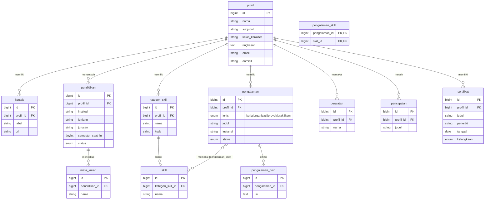

# CV Abyan Alfairus — Laravel 12 (Database-Driven)

Website CV / portofolio pribadi bertema game RPG retro.
Dibangun dengan **Laravel 12** dan **MySQL**. Seluruh konten profil (data diri, pendidikan,
pengalaman, skill, pencapaian, sertifikat, kontak) **dibaca dari database**. View Blade hanya
berisi struktur tampilan, tidak ada teks profil yang diketik langsung.

- **Nama:** Abyan Alfairus
- **NIM:** 2430511014 · Kelas A
- **Program studi:** Teknik Informatika, Universitas Muhammadiyah Sukabumi

---

## 1. Struktur database

12 tabel konten, semuanya terhubung ke tabel `profil`:



| Tabel | Isi | Relasi |
|---|---|---|
| `profil` | Data diri utama | induk semua tabel |
| `kontak` | WhatsApp, email, GitHub, LinkedIn | `profil` 1–N |
| `pendidikan` | Riwayat pendidikan | `profil` 1–N |
| `mata_kuliah` | Mata kuliah relevan | `pendidikan` 1–N |
| `kategori_skill` | Cabang skill (WEB, MOBILE, …) | `profil` 1–N |
| `skill` | Keahlian | `kategori_skill` 1–N |
| `pengalaman` | Kerja, **organisasi**, proyek, praktikum | `profil` 1–N |
| `pengalaman_poin` | Butir rincian pengalaman | `pengalaman` 1–N |
| `pengalaman_skill` | Skill yang dipakai di tiap pengalaman | pivot N–N `pengalaman` ↔ `skill` |
| `peralatan` | Tools (Git, Laragon, …) | `profil` 1–N |
| `pencapaian` | Pencapaian / achievement | `profil` 1–N |
| `sertifikat` | Sertifikat kursus & seminar | `profil` 1–N |

Semua foreign key memakai `ON DELETE CASCADE`. Kolom `urutan` mengatur urutan tampil.

### Data yang dihitung otomatis dari relasi

- **Level** = `pendidikan.semester_saat_ini`; **bar XP** = semester / total semester.
- **Bar WEB / MOB / ALG / SYS** = jumlah pengalaman yang memakai skill di kategori itu (lewat `pengalaman_skill`).
- **Kotak hijau di skill tree** = jumlah pengalaman yang memakai skill tersebut.
- **Chip REWARD** di tiap quest = daftar skill dari tabel pivot.
- **Angka quest selesai / aktif / achievement / sertifikat** = hasil `count()` dari tabelnya.

---

## 2. Struktur kode

| File | Fungsi |
|---|---|
| `database/migrations/2026_11_07_*` | 12 migration, satu per tabel |
| `app/Models/*.php` | Model Eloquent + relasi (`hasMany`, `belongsTo`, `belongsToMany`, `hasOne`) |
| `database/seeders/CvSeeder.php` | Isi awal database dengan data CV |
| `app/Http/Controllers/CvController.php` | Mengambil `Profil::lengkap()` (eager loading semua relasi), menghitung angka turunan |
| `app/Http/Controllers/CvPdfController.php` | Membuat CV versi PDF dari data yang sama |
| `resources/views/partials/*.blade.php` | Satu file per bagian halaman, hanya menampilkan data dari model |
| `public/css/cv.css`, `public/js/cv.js` | Tampilan dan interaksi (avatar pixel, bintang jatuh, filter quest) |

---

## 3. Menjalankan di Laragon

1. Jalankan Laragon, klik **Start All** (Apache + MySQL).
2. Buat database bernama `cv_abyan` (Laragon → **Database** → HeidiSQL → klik kanan → *Create new → Database*).
   Atau lewat terminal: `mysql -u root -e "CREATE DATABASE cv_abyan"`
3. Pastikan isi `.env` seperti ini:
   ```env
   DB_CONNECTION=mysql
   DB_HOST=127.0.0.1
   DB_PORT=3306
   DB_DATABASE=cv_abyan
   DB_USERNAME=root
   DB_PASSWORD=
   ```
4. Di terminal folder proyek:
   ```bash
   composer install          # jika folder vendor belum ada
   composer require barryvdh/laravel-dompdf   # sekali saja, untuk fitur download PDF
   php artisan key:generate  # jika APP_KEY masih kosong
   php artisan migrate:fresh --seed
   php artisan serve
   ```
5. Buka `http://127.0.0.1:8000`.

## 4. Download CV (PDF)

Halaman web punya tombol **⬇ DOWNLOAD CV** (di layar judul dan bagian PARTY).
PDF dibuat oleh paket **barryvdh/laravel-dompdf** dari data yang sama di database, dengan format formal A4.

| URL | Hasil |
|---|---|
| `/cv/download` | File `CV-Abyan-Alfairus.pdf` langsung terunduh |
| `/cv/download?lihat=1` | PDF dibuka di tab browser (pratinjau) |

File terkait: `app/Http/Controllers/CvPdfController.php` dan `resources/views/pdf/cv.blade.php`.
Pengalaman di PDF otomatis dikelompokkan per jenis: Kerja, Organisasi, Proyek, Praktikum.

Paket dipasang sekali dengan:
```bash
composer require barryvdh/laravel-dompdf
```

## 5. Panel Admin (mengubah isi CV)

Buka **`/admin`** (mis. `http://127.0.0.1:8000/admin`) lalu login.

| | Default |
|---|---|
| Email | `abyanalfairus@gmail.com` |
| Password | `admin12345` |

Akun dibuat oleh `AdminSeeder` saat `php artisan migrate:fresh --seed`. Untuk mengganti, tambahkan di `.env`
lalu jalankan `php artisan db:seed --class=AdminSeeder`:
```env
ADMIN_EMAIL=email@anda.com
ADMIN_PASSWORD=password-yang-kuat
```
> **Wajib ganti password default sebelum website di-hosting.**

### Menu

| Menu | Tabel | Bisa |
|---|---|---|
| Profil | `profil` | ubah (hanya 1 baris) |
| Kontak | `kontak` | tambah, ubah, hapus |
| Pendidikan | `pendidikan` + `mata_kuliah` | mata kuliah diisi per baris: `Nama | keterangan` |
| Pengalaman | `pengalaman` + `pengalaman_poin` + `pengalaman_skill` | pilih jenis (kerja/organisasi/proyek/praktikum), rincian per baris, centang skill |
| Sertifikat | `sertifikat` | termasuk upload PDF ke `public/sertifikat` |
| Pencapaian | `pencapaian` | tambah, ubah, hapus |
| Kategori Skill | `kategori_skill` | juga menentukan bar status di web |
| Skill | `skill` | dikelompokkan per kategori |
| Tools | `peralatan` | tambah, ubah, hapus |

Setiap perubahan langsung tampil di halaman web dan PDF.

### Struktur kode admin

| File | Fungsi |
|---|---|
| `app/Http/Controllers/Admin/AuthController.php` | Login/logout (tabel `users`), dibatasi 5 percobaan per menit |
| `app/Http/Controllers/Admin/CrudController.php` | Controller dasar: index, create, store, edit, update, destroy + validasi, upload file, relasi |
| `app/Http/Controllers/Admin/*Controller.php` | Satu per tabel: cukup mendefinisikan `fields()` (input + aturan validasi) dan `kolom()` (kolom tabel) |
| `resources/views/admin/` | Layout sidebar, login, dashboard, `crud/index`, `crud/form`, `crud/field` |
| `public/css/admin.css` | Tampilan panel admin |

Semua route admin memakai middleware `auth` dan CSRF bawaan Laravel.

## 6. Hosting (cPanel)

1. Di komputer: `composer install --no-dev --optimize-autoloader`, lalu zip seluruh folder proyek.
2. cPanel → **MySQL Databases**: buat database + user, beri user akses **ALL PRIVILEGES**.
3. Upload & ekstrak proyek:
   - **Cara A (rapi):** ekstrak ke `/home/USERNAME/cv-laravel`, pindahkan isi `public/` ke `public_html/`,
     lalu di `public_html/index.php` ubah path menjadi `__DIR__.'/../cv-laravel/...'` dan tambahkan
     `$app->usePublicPath(__DIR__);` setelah baris `$app = ...`.
   - **Cara B (cepat):** ekstrak langsung ke `public_html/`. File `.htaccess` di root sudah
     mengarahkan semua akses ke folder `public/` dan memblokir `.env`.
4. Edit `.env` di server: `APP_ENV=production`, `APP_DEBUG=false`, `ADMIN_PASSWORD=...` (password baru), `APP_URL=https://domainanda.com`,
   dan isi `DB_DATABASE`, `DB_USERNAME`, `DB_PASSWORD` sesuai yang dibuat di cPanel.
5. Isi database:
   - Jika ada **Terminal/SSH**: `php artisan migrate --seed --force`
   - Jika tidak ada: jalankan `migrate:fresh --seed` di Laragon, export database `cv_abyan`
     dari HeidiSQL (*Export database as SQL*), lalu import file `.sql` itu lewat **phpMyAdmin** di cPanel.
6. Pastikan folder `storage/` dan `bootstrap/cache/` ber-permission `775`.
